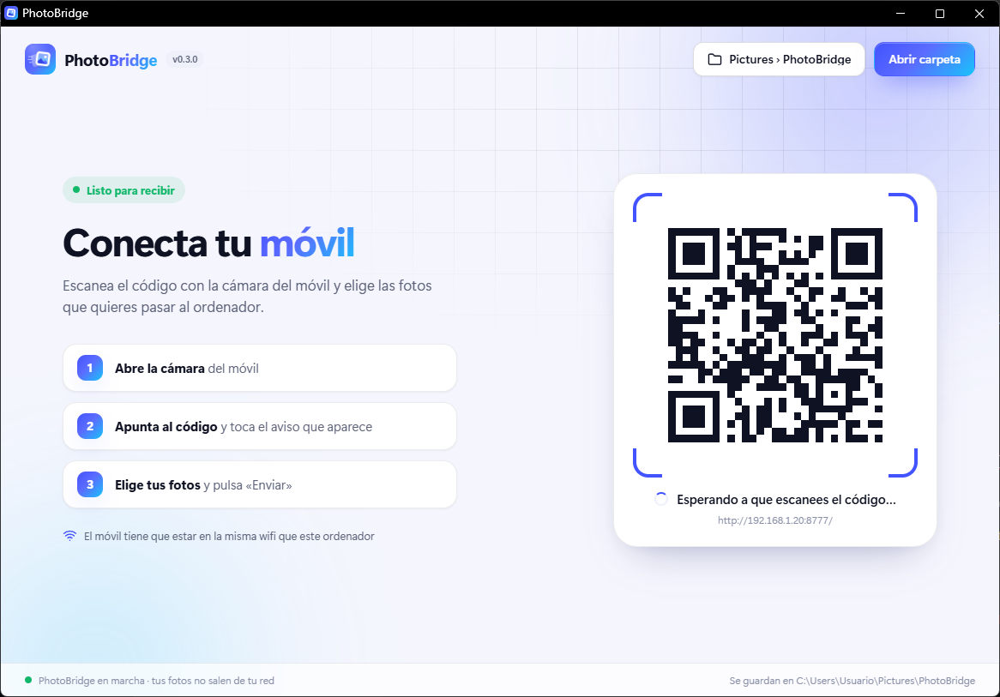
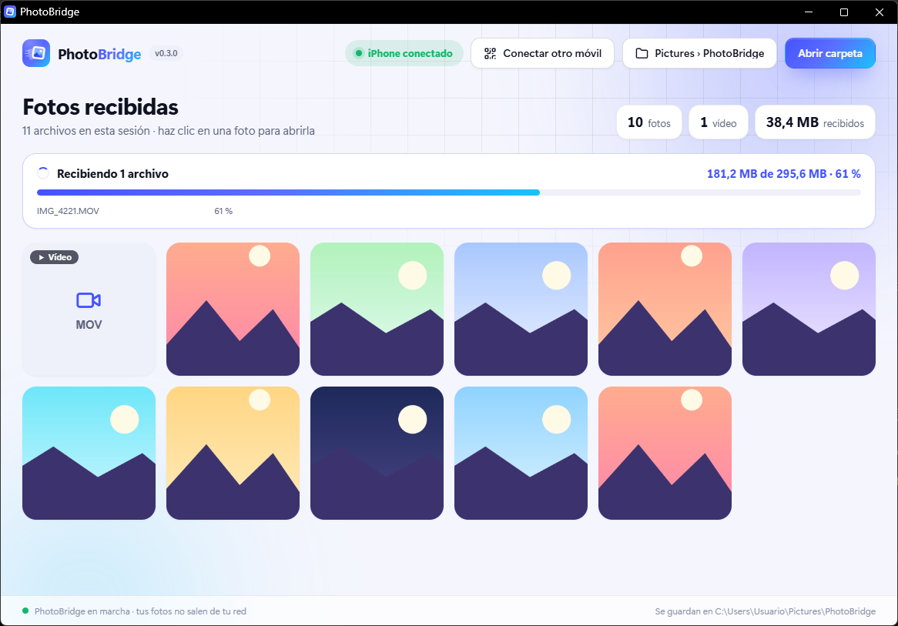
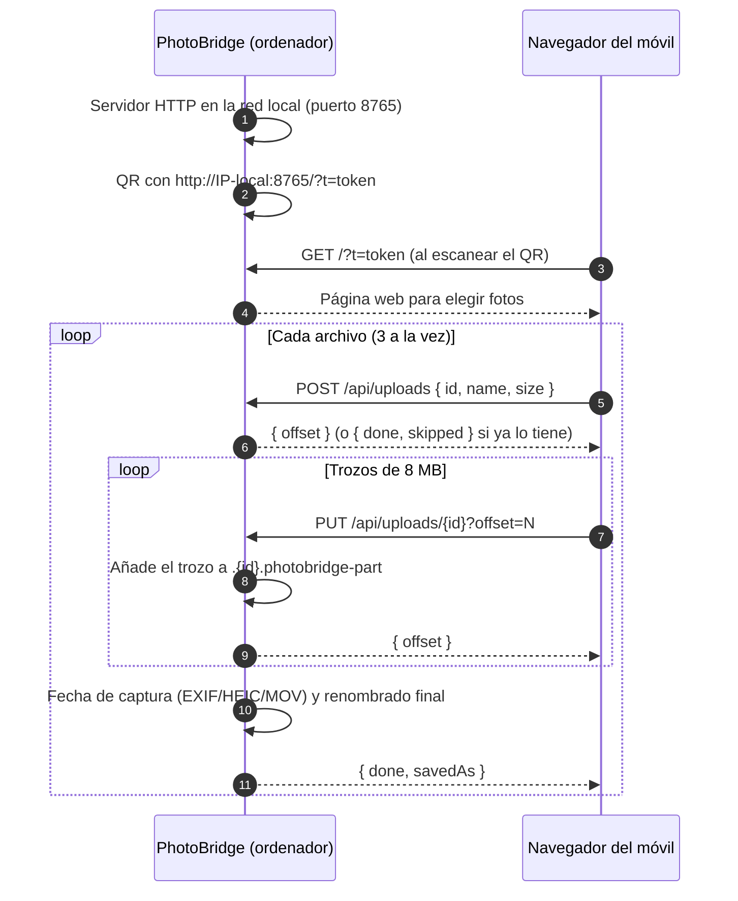

<div align="center">

<picture>
  <source media="(prefers-color-scheme: dark)" srcset="branding/export/logo-horizontal-white.png">
  
</picture>

### Pasa las fotos del móvil al ordenador por tu wifi.<br>Sin cables, sin cuentas y sin nube.

<p>
  
  
  
  
  
</p>

<a href="https://github.com/Ivanrr462/PhotoBridge/releases/latest/download/PhotoBridge.exe"></a>

[Cómo funciona](#cómo-funciona) · [Capturas](#capturas) · [Desarrollo](#desarrollo) · [Publicar una versión](#publicar-una-versión) · [Releases](https://github.com/Ivanrr462/PhotoBridge/releases)

<br>

<picture>
  <source media="(prefers-color-scheme: dark)" srcset="docs/screenshots/landing.png">
  
</picture>

</div>

---

## Qué es PhotoBridge

Pasar fotos del móvil al ordenador sigue siendo un lío para mucha gente: cables que no aparecen, el ordenador que no reconoce el móvil, fotos enviadas por WhatsApp que llegan comprimidas o subidas a la nube para volver a bajarlas.

**PhotoBridge lo reduce a escanear un código QR.** El ordenador ejecuta un pequeño programa que muestra un QR. El móvil lo escanea con la cámara y abre una página web servida por el propio ordenador. Desde ahí se eligen las fotos y llegan directamente a una carpeta del PC por la red de casa.

| | |
|---|---|
| **Sin instalar nada en el móvil** | Funciona en el navegador de cualquier Android o iPhone. |
| **Sin cuentas ni nube** | No hay registro ni servidores intermedios. Las fotos nunca salen de tu red. |
| **Calidad original** | Los archivos llegan sin comprimir. La fecha real de captura se lee de los metadatos (EXIF, HEIC, MOV/MP4). |
| **Vídeos grandes sin miedo** | Se envían en trozos de 8 MB. Si se bloquea la pantalla o se corta la wifi, siguen donde se quedaron. |
| **Rápido con muchas fotos** | Tres archivos a la vez, conexiones persistentes, y velocidad y tiempo restante en pantalla. |
| **Sin duplicados** | Reconoce lo que ya está en el ordenador y no lo vuelve a copiar. |
| **Galería en el PC** | Al conectar el móvil, el QR deja paso a una galería en directo: progreso de lo que llega, contadores y miniaturas (generadas por el propio Windows). |
| **Visor integrado** | Un clic abre la foto o el vídeo dentro de PhotoBridge, a pantalla completa, con flechas, zoom y tira de miniaturas. Las HEIC se ven gracias a Windows. |
| **Borrar sin miedo** | Borra una foto o una selección desde la propia ventana. Van a la Papelera de reciclaje, así que se pueden recuperar. |
| **Subida visual en el móvil** | Cada miniatura muestra su propio progreso y su ✓ al llegar, con el porcentaje total, la velocidad y el tiempo restante. |
| **Se actualiza solo** | Al abrirlo, avisa si hay una versión nueva y se actualiza con un clic: descarga, comprueba y se reinicia. |
| **Un solo `.exe`** | Unos 11 MB, sin instalador y sin necesidad de tener Python. |
| **Seguro por defecto** | Clave secreta en el QR, solo acepta conexiones de la red local y nunca sobrescribe archivos. |

## Capturas

<table>
  <tr>
    <td align="center" valign="top" width="25%"><br><sub><b>1.</b> Elegir fotos</sub></td>
    <td align="center" valign="top" width="25%"><br><sub><b>2.</b> Revisar</sub></td>
    <td align="center" valign="top" width="25%"><br><sub><b>3.</b> Enviando</sub></td>
    <td align="center" valign="top" width="25%"><br><sub><b>4.</b> ¡Listo!</sub></td>
  </tr>
</table>

<table>
  <tr>
    <td align="center" valign="top" width="50%"><br><sub><b>Esperando:</b> el QR y los pasos para conectar</sub></td>
    <td align="center" valign="top" width="50%"><br><sub><b>Móvil conectado:</b> lo que llega, en directo</sub></td>
  </tr>
</table>

**La ventana del ordenador:** mientras no hay ningún móvil conectado, muestra el QR en grande y los pasos para conectar. En cuanto el móvil lo escanea, el QR desaparece y la ventana pasa a la galería: qué móvil está conectado, el progreso de lo que se está recibiendo, cuántas fotos y vídeos han llegado y sus miniaturas. Para conectar otro móvil, el botón «Conectar otro móvil» vuelve a mostrar el QR.

- **Ver:** un clic en una miniatura la abre en el visor integrado. Se navega con ← y →, con un clic se hace zoom y los vídeos se reproducen ahí mismo. Desde el visor también se puede abrir con otra aplicación o mostrar en la carpeta.
- **Borrar:** al pasar el ratón por una miniatura aparecen su papelera y su casilla. Con «Seleccionar» (o Ctrl+A) se marcan varias y se borran de una vez. También funciona la tecla Supr en el visor. Siempre se pide confirmación y los archivos van a la **Papelera de reciclaje** de Windows.

## Uso

1. **Descarga [`PhotoBridge.exe`](https://github.com/Ivanrr462/PhotoBridge/releases/latest/download/PhotoBridge.exe)** y ábrelo. Aparecerá una ventana con un código QR.
2. **Escanea el QR** con la cámara del móvil, que tiene que estar conectado a la **misma wifi** que el ordenador.
3. **Elige las fotos y pulsa «Enviar».** Llegan a `Imágenes\PhotoBridge`.

> [!NOTE]
> **La primera vez** es normal ver algún aviso, porque el programa todavía es nuevo y no está firmado digitalmente:
> - El navegador dice que el archivo «no se descarga habitualmente» → **Conservar**.
> - Windows SmartScreen: «Windows protegió su PC» → **Más información → Ejecutar de todas formas**.
> - Firewall de Windows → marca **Redes privadas** y pulsa **Permitir acceso**.

<details>
<summary><b>Solución de problemas</b></summary>

<br>

| Problema | Causa habitual y solución |
|---|---|
| El móvil no abre la página al escanear el QR | El móvil está usando datos (4G/5G) o está en otra wifi. Conéctalo a la misma red que el ordenador. |
| Sigue sin conectar estando en la misma wifi | Windows tiene la red marcada como **Pública**. Cámbiala a **Privada** en *Configuración › Red e Internet*. |
| Funciona en casa pero no en la oficina o un hotel | Las redes de invitados suelen aislar los dispositivos entre sí. Es una limitación de la red. |
| La página dice «Enlace no válido» | El enlace es antiguo. Vuelve a escanear el QR de la ventana. |
| Se cortó el envío | Vuelve a la página: sigue sola donde se quedó. Si un archivo falló varias veces, pulsa **Reintentar los que fallaron**. |

</details>

### iPhone

| | |
|---|---|
| **Live Photos** | Desde el navegador, iOS solo entrega la foto fija (el vídeo de la Live Photo no es accesible desde una web). Para conservar el movimiento: en *Fotos*, abre la Live Photo → **Compartir → Guardar como vídeo**, y envía ese vídeo. |
| **Vídeos en calidad original** | Al elegir vídeos desde la fototeca, iOS puede recomprimirlos. Para enviarlos tal cual: **Compartir → Guardar en Archivos** y, en PhotoBridge, **Elegir desde Archivos**. |
| **HEIC** | El selector pide también `image/heic` para que iOS pueda entregar el original. Si Safari pone un nombre temporal, PhotoBridge renombra el archivo con la fecha de captura (`IMG_20240714_183000.heic`). |

La web detecta el iPhone y muestra estas instrucciones en la propia página.

## Cómo funciona



- **Sin servidor externo.** El PC sirve tanto la web como la API. El móvil solo necesita un navegador.
- **Id por contenido.** El móvil identifica cada archivo con un hash de su tamaño y de tres muestras de 64 KB (principio, medio y final). Con él se retoman los envíos cortados y se reconocen los ya recibidos, aunque el iPhone cambie el nombre o la fecha.
- **Reanudable.** Si un trozo se corta, el móvil pregunta al PC cuántos bytes tiene y sigue desde ahí. Si la página está en segundo plano (pantalla bloqueada), espera a que vuelva para reintentar.
- **Sin multipart.** El cuerpo de cada trozo son los bytes tal cual: el servidor los escribe al disco en bloques de 1 MB, sin cargar el archivo en memoria.
- **Escritura segura.** Mientras llega, el archivo vive en un temporal oculto. Solo al completarse se renombra a su nombre final, así que nunca quedan fotos a medias. Los temporales abandonados se borran a los 3 días.

### API local

| Método | Ruta | Autenticación | Descripción |
|---|---|---|---|
| `GET` | `/?t=<token>` | token en la URL | Página para el móvil (o «Enlace no válido» si el token no es correcto). |
| `GET` | `/static/<archivo>` | — | Recursos de la página (JS, CSS, iconos). Lista cerrada de archivos. |
| `GET` | `/api/info` | `X-Token` | Nombre del equipo y versión. |
| `POST` | `/api/uploads` | `X-Token` | Abre o retoma un envío. Cuerpo JSON `{id, name, size, lastModified}`. Responde `{offset, done, skipped?, savedAs?}`. |
| `PUT` | `/api/uploads/<id>?offset=N` | `X-Token` | Añade un trozo en la posición `N`. Responde `{offset, done, savedAs?}`, o `409 {offset}` si `N` no coincide. |

## Seguridad y privacidad

- **Token por equipo:** se genera la primera vez con `secrets.token_urlsafe` y se guarda en `%APPDATA%\PhotoBridge\config.json`. Se compara en tiempo constante (`hmac.compare_digest`).
- **Solo red local:** se rechazan las conexiones que no vienen de direcciones privadas, de bucle local o de enlace local.
- **Nombres saneados:** se eliminan rutas (`../`), caracteres prohibidos en Windows y nombres reservados (`CON`, `NUL`, `COM1`…).
- **Sin sobrescribir:** si el nombre ya existe, se guarda como `foto (1).jpg`.
- **Espacio en disco:** se rechaza una subida si dejaría menos de 200 MB libres.
- **Índice local de recibidos:** para no duplicar, se guarda en `%APPDATA%\PhotoBridge\sent.json` qué id corresponde a qué archivo. Si borras el archivo, se puede volver a enviar.
- **Nada sale de casa:** las fotos solo viajan por la red local. No hay telemetría, ni cuentas, ni servicios de terceros.
- **La ventana:** es una página que sirve el propio PhotoBridge en `/desktop`, que solo responde a este equipo (`127.0.0.1`) y pide una clave aleatoria distinta en cada arranque. Se muestra con Edge en modo aplicación (`--app`), con un perfil propio en `%LOCALAPPDATA%\PhotoBridge\ventana` y la sincronización y el inicio de sesión automático desactivados. Si Edge no está, se usa una ventana clásica de Tkinter (también con `--classic`).
- **Actualizaciones:** al arrancar, el programa consulta la última release en `api.github.com` (solo envía `PhotoBridge/<versión>` como User-Agent). Al actualizar, comprueba el tamaño y el SHA-256 del `.exe` descargado antes de sustituir el actual. Se puede desactivar con `"check_updates": false` en `%APPDATA%\PhotoBridge\config.json`. Solo funciona si el repositorio es público.

## Estructura del proyecto

```
PhotoBridge/
├── desktop/                    App de escritorio (Python, solo librería estándar + qrcode)
│   ├── photobridge/
│   │   ├── app.py              Punto de entrada: ventana o modo consola (--no-gui)
│   │   ├── server.py           Servidor HTTP: web del móvil y API de subida
│   │   ├── storage.py          Subidas por trozos, reanudación, duplicados y guardado seguro
│   │   ├── metadata.py         Fecha de captura desde EXIF, HEIC y MOV/MP4
│   │   ├── desktop_ui.py       Ventana del PC: página HTML en Edge (modo app) y eventos en directo
│   │   ├── gui.py              Ventana clásica de Tkinter (respaldo si no hay Edge)
│   │   ├── thumbs.py           Miniaturas con la API del Explorador de Windows
│   │   ├── trash.py            Enviar archivos a la Papelera de reciclaje
│   │   ├── updater.py          Comprobación, descarga e instalación de versiones nuevas
│   │   ├── network.py          IP local y filtro de clientes
│   │   ├── config.py           Token, puerto y carpeta
│   │   ├── qr.py               Generación del QR
│   │   └── web/                Página del móvil y ventana del PC (HTML, CSS y JS sin dependencias)
│   ├── tests/                  Tests con unittest
│   └── build.ps1               Tests + PyInstaller → dist/PhotoBridge.exe
├── landing/                    Web pública de descarga (Astro)
├── branding/                   Logo en SVG y script para exportar PNG e .ico
├── docs/screenshots/           Capturas de este README
└── .github/workflows/          Compilación y publicación de releases
```

## Desarrollo

### App de escritorio

Requisitos: Windows y Python 3.11 o superior.

```powershell
cd desktop
python -m venv .venv
.\.venv\Scripts\python.exe -m pip install -r requirements.txt -r requirements-dev.txt
```

| Tarea | Comando |
|---|---|
| Abrir con ventana | `.\.venv\Scripts\python.exe -m photobridge` |
| Ventana clásica (sin Edge) | `.\.venv\Scripts\python.exe -m photobridge --classic` |
| Modo consola (QR en la terminal) | `.\.venv\Scripts\python.exe -m photobridge --no-gui` |
| Otro puerto o carpeta | `... -m photobridge --port 9000 --dest D:\Fotos` |
| Tests | `.\.venv\Scripts\python.exe -m unittest discover -s tests -t .` |
| Generar `PhotoBridge.exe` | `.\build.ps1` |

### Landing

Requisitos: Node.js 22.12 o superior.

```powershell
cd landing
npm install
npm run dev      # http://localhost:4321
npm run build    # sitio estático en landing/dist
```

Los botones de descarga apuntan a `releases/latest/download/PhotoBridge.exe` (definido en [`landing/src/config.ts`](landing/src/config.ts)). GitHub redirige ese enlace al `.exe` de la última release, así que el navegador lo descarga directamente.

#### Publicación en Vercel

La landing se despliega en [Vercel](https://vercel.com) importando este repositorio con **Root Directory: `landing`**. Vercel detecta Astro solo (compila con `astro build` y publica `dist`), y la versión de Node la toma del `engines` de [`landing/package.json`](landing/package.json). Cada `git push` a `main` vuelve a desplegarla.

- **Dominio propio:** añádelo en *Vercel → proyecto → Settings → Domains* y crea en tu proveedor (por ejemplo Nominalia) los registros DNS que te indique Vercel.
- **URL de la web:** por defecto es `https://www.photobridge.es` (en [`landing/astro.config.mjs`](landing/astro.config.mjs)). Se usa para la URL canónica y la imagen al compartir. Para cambiarla sin tocar el código, define la variable de entorno `SITE_URL` en Vercel.

### Logo

Los originales son [`branding/logo.svg`](branding/logo.svg) y [`branding/logo-small.svg`](branding/logo-small.svg) (este último para tamaños pequeños). Para regenerar todos los PNG y el `.ico` y copiarlos a la app y a la landing:

```powershell
desktop\.venv\Scripts\python.exe branding\build_brand.py
```

## Publicar una versión

1. Actualiza la versión en `desktop/photobridge/__init__.py` y en `landing/src/config.ts`.
2. Haz commit, crea la etiqueta y súbela:

   ```powershell
   git tag v0.1.1
   git push origin main v0.1.1
   ```

3. El workflow [`release.yml`](.github/workflows/release.yml) pasa los tests, compila el `.exe` en Windows y publica la release con el ejecutable adjunto. La landing empieza a descargar la nueva versión automáticamente, y quien ya tenga PhotoBridge verá el aviso para actualizar la próxima vez que lo abra.

## Hoja de ruta

- [ ] Firma de código del `.exe`, para eliminar el aviso de SmartScreen
- [ ] Minimizar a la bandeja del sistema y arrancar con Windows
- [ ] Versión para macOS
- [ ] Enviar archivos también del ordenador al móvil
- [ ] Organizar automáticamente por fecha (`2026/11/…`)

---

<div align="center">
<sub>Hecho por <a href="https://github.com/Ivanrr462">Ivanrr462</a> · Tus fotos, de tu móvil a tu ordenador, sin salir de casa.</sub>
</div>
