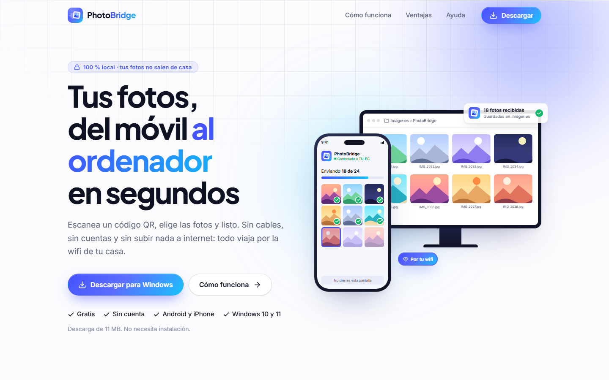
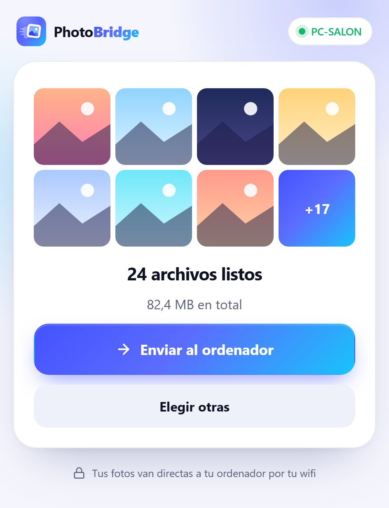
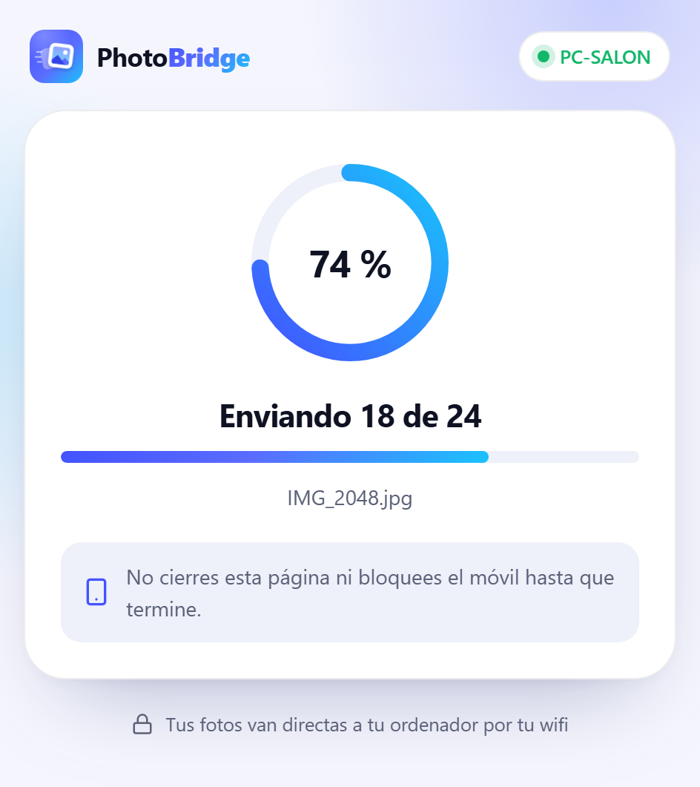
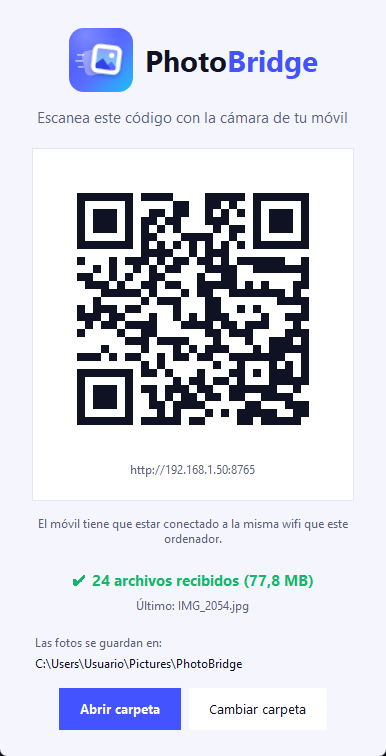
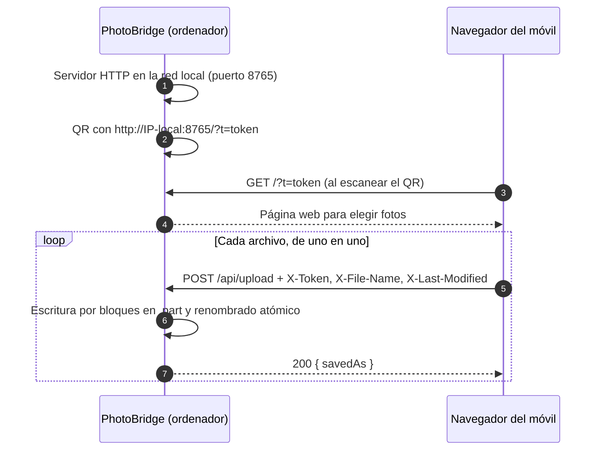

<div align="center">

<picture>
  <source media="(prefers-color-scheme: dark)" srcset="branding/export/logo-horizontal-white.png">
  
</picture>

### Pasa las fotos del móvil al ordenador por tu wifi.<br>Sin cables, sin cuentas y sin nube.

<p>
  
  
  
  
  
</p>

<a href="https://github.com/Ivanrr462/PhotoBridge/releases/latest/download/PhotoBridge.exe"></a>

[Cómo funciona](#cómo-funciona) · [Capturas](#capturas) · [Desarrollo](#desarrollo) · [Publicar una versión](#publicar-una-versión) · [Releases](https://github.com/Ivanrr462/PhotoBridge/releases)

<br>

<picture>
  <source media="(prefers-color-scheme: dark)" srcset="docs/screenshots/landing.png">
  
</picture>

</div>

---

## Qué es PhotoBridge

Pasar fotos del móvil al ordenador sigue siendo un lío para mucha gente: cables que no aparecen, el ordenador que no reconoce el móvil, fotos enviadas por WhatsApp que llegan comprimidas o subidas a la nube para volver a bajarlas.

**PhotoBridge lo reduce a escanear un código QR.** El ordenador ejecuta un pequeño programa que muestra un QR. El móvil lo escanea con la cámara y abre una página web servida por el propio ordenador. Desde ahí se eligen las fotos y llegan directamente a una carpeta del PC por la red de casa.

| | |
|---|---|
| **Sin instalar nada en el móvil** | Funciona en el navegador de cualquier Android o iPhone. |
| **Sin cuentas ni nube** | No hay registro ni servidores intermedios. Las fotos nunca salen de tu red. |
| **Calidad original** | Los archivos llegan sin comprimir y conservan su fecha original. |
| **Un solo `.exe`** | Unos 11 MB, sin instalador y sin necesidad de tener Python. |
| **Seguro por defecto** | Clave secreta en el QR, solo acepta conexiones de la red local y nunca sobrescribe archivos. |
| **Pensado para no expertos** | Una ventana, un QR y un botón. Si algo falla, solo se reintentan las fotos que no llegaron. |

## Capturas

<table>
  <tr>
    <td align="center" valign="top" width="25%"><br><sub><b>1.</b> Elegir fotos</sub></td>
    <td align="center" valign="top" width="25%"><br><sub><b>2.</b> Vista previa</sub></td>
    <td align="center" valign="top" width="25%"><br><sub><b>3.</b> Enviando</sub></td>
    <td align="center" valign="top" width="25%"><br><sub><b>4.</b> ¡Listo!</sub></td>
  </tr>
</table>

<table>
  <tr>
    <td valign="top" width="300"></td>
    <td valign="top">
      <b>La ventana del ordenador</b><br><br>
      Muestra el QR para conectar el móvil, cuántas fotos han llegado y la carpeta de destino, que se puede abrir o cambiar con un clic.<br><br>
      El QR se regenera solo si cambia la red o la IP del ordenador.
    </td>
  </tr>
</table>

## Uso

1. **Descarga [`PhotoBridge.exe`](https://github.com/Ivanrr462/PhotoBridge/releases/latest/download/PhotoBridge.exe)** y ábrelo. Aparecerá una ventana con un código QR.
2. **Escanea el QR** con la cámara del móvil, que tiene que estar conectado a la **misma wifi** que el ordenador.
3. **Elige las fotos y pulsa «Enviar».** Llegan a `Imágenes\PhotoBridge`.

> [!NOTE]
> **La primera vez** es normal ver algún aviso, porque el programa todavía es nuevo y no está firmado digitalmente:
> - El navegador dice que el archivo «no se descarga habitualmente» → **Conservar**.
> - Windows SmartScreen: «Windows protegió su PC» → **Más información → Ejecutar de todas formas**.
> - Firewall de Windows → marca **Redes privadas** y pulsa **Permitir acceso**.

<details>
<summary><b>Solución de problemas</b></summary>

<br>

| Problema | Causa habitual y solución |
|---|---|
| El móvil no abre la página al escanear el QR | El móvil está usando datos (4G/5G) o está en otra wifi. Conéctalo a la misma red que el ordenador. |
| Sigue sin conectar estando en la misma wifi | Windows tiene la red marcada como **Pública**. Cámbiala a **Privada** en *Configuración › Red e Internet*. |
| Funciona en casa pero no en la oficina o un hotel | Las redes de invitados suelen aislar los dispositivos entre sí. Es una limitación de la red. |
| La página dice «Enlace no válido» | El enlace es antiguo. Vuelve a escanear el QR de la ventana. |
| Se cortó el envío | La pantalla del móvil se bloqueó. Pulsa **Reintentar las que fallaron**. |

</details>

## Cómo funciona



- **Sin servidor externo.** El PC sirve tanto la web como la API. El móvil solo necesita un navegador.
- **Subida sin multipart.** El cuerpo de la petición es el archivo tal cual y los metadatos van en cabeceras. Así el servidor escribe directamente al disco en bloques de 1 MB, sin cargar el archivo en memoria.
- **Escritura segura.** Cada archivo se escribe primero en un temporal y luego se renombra a su nombre final. Si la conexión se corta, el temporal se borra y no quedan fotos a medias.

### API local

| Método | Ruta | Autenticación | Descripción |
|---|---|---|---|
| `GET` | `/?t=<token>` | token en la URL | Página para el móvil (o «Enlace no válido» si el token no es correcto). |
| `GET` | `/static/<archivo>` | — | Recursos de la página (JS, CSS, iconos). Lista cerrada de archivos. |
| `GET` | `/api/info` | `X-Token` | Nombre del equipo y versión. |
| `POST` | `/api/upload` | `X-Token` | Sube un archivo. Cabeceras: `X-File-Name` (URL-encoded) y `X-Last-Modified` (ms). |

## Seguridad y privacidad

- **Token por equipo:** se genera la primera vez con `secrets.token_urlsafe` y se guarda en `%APPDATA%\PhotoBridge\config.json`. Se compara en tiempo constante (`hmac.compare_digest`).
- **Solo red local:** se rechazan las conexiones que no vienen de direcciones privadas, de bucle local o de enlace local.
- **Nombres saneados:** se eliminan rutas (`../`), caracteres prohibidos en Windows y nombres reservados (`CON`, `NUL`, `COM1`…).
- **Sin sobrescribir:** si el nombre ya existe, se guarda como `foto (1).jpg`.
- **Espacio en disco:** se rechaza una subida si dejaría menos de 200 MB libres.
- **Nada sale de casa:** no hay telemetría, ni cuentas, ni servicios de terceros.

## Estructura del proyecto

```
PhotoBridge/
├── desktop/                    App de escritorio (Python, solo librería estándar + qrcode)
│   ├── photobridge/
│   │   ├── app.py              Punto de entrada: ventana o modo consola (--no-gui)
│   │   ├── gui.py              Ventana Tkinter: QR, contador y carpeta destino
│   │   ├── server.py           Servidor HTTP: web del móvil y API de subida
│   │   ├── storage.py          Guardado seguro de archivos
│   │   ├── network.py          IP local y filtro de clientes
│   │   ├── config.py           Token, puerto y carpeta
│   │   ├── qr.py               Generación del QR
│   │   └── web/                Página del móvil (HTML, CSS y JS sin dependencias)
│   ├── tests/                  Tests con unittest
│   └── build.ps1               Tests + PyInstaller → dist/PhotoBridge.exe
├── landing/                    Web pública de descarga (Astro)
├── branding/                   Logo en SVG y script para exportar PNG e .ico
├── docs/screenshots/           Capturas de este README
└── .github/workflows/          Compilación y publicación de releases
```

## Desarrollo

### App de escritorio

Requisitos: Windows y Python 3.11 o superior.

```powershell
cd desktop
python -m venv .venv
.\.venv\Scripts\python.exe -m pip install -r requirements.txt -r requirements-dev.txt
```

| Tarea | Comando |
|---|---|
| Abrir con ventana | `.\.venv\Scripts\python.exe -m photobridge` |
| Modo consola (QR en la terminal) | `.\.venv\Scripts\python.exe -m photobridge --no-gui` |
| Otro puerto o carpeta | `... -m photobridge --port 9000 --dest D:\Fotos` |
| Tests | `.\.venv\Scripts\python.exe -m unittest discover -s tests -t .` |
| Generar `PhotoBridge.exe` | `.\build.ps1` |

### Landing

Requisitos: Node.js 22.12 o superior.

```powershell
cd landing
npm install
npm run dev      # http://localhost:4321
npm run build    # sitio estático en landing/dist
```

Los botones de descarga apuntan a `releases/latest/download/PhotoBridge.exe` (definido en [`landing/src/config.ts`](landing/src/config.ts)). GitHub redirige ese enlace al `.exe` de la última release, así que el navegador lo descarga directamente.

### Logo

Los originales son [`branding/logo.svg`](branding/logo.svg) y [`branding/logo-small.svg`](branding/logo-small.svg) (este último para tamaños pequeños). Para regenerar todos los PNG y el `.ico` y copiarlos a la app y a la landing:

```powershell
desktop\.venv\Scripts\python.exe branding\build_brand.py
```

## Publicar una versión

1. Actualiza la versión en `desktop/photobridge/__init__.py` y en `landing/src/config.ts`.
2. Haz commit, crea la etiqueta y súbela:

   ```powershell
   git tag v0.1.1
   git push origin main v0.1.1
   ```

3. El workflow [`release.yml`](.github/workflows/release.yml) pasa los tests, compila el `.exe` en Windows y publica la release con el ejecutable adjunto. La landing empieza a descargar la nueva versión automáticamente.

## Hoja de ruta

- [ ] Firma de código del `.exe`, para eliminar el aviso de SmartScreen
- [ ] Minimizar a la bandeja del sistema y arrancar con Windows
- [ ] Versión para macOS
- [ ] Enviar archivos también del ordenador al móvil
- [ ] Organizar automáticamente por fecha (`2026/11/…`)

---

<div align="center">
<sub>Hecho por <a href="https://github.com/Ivanrr462">Ivanrr462</a> · Tus fotos, de tu móvil a tu ordenador, sin salir de casa.</sub>
</div>
